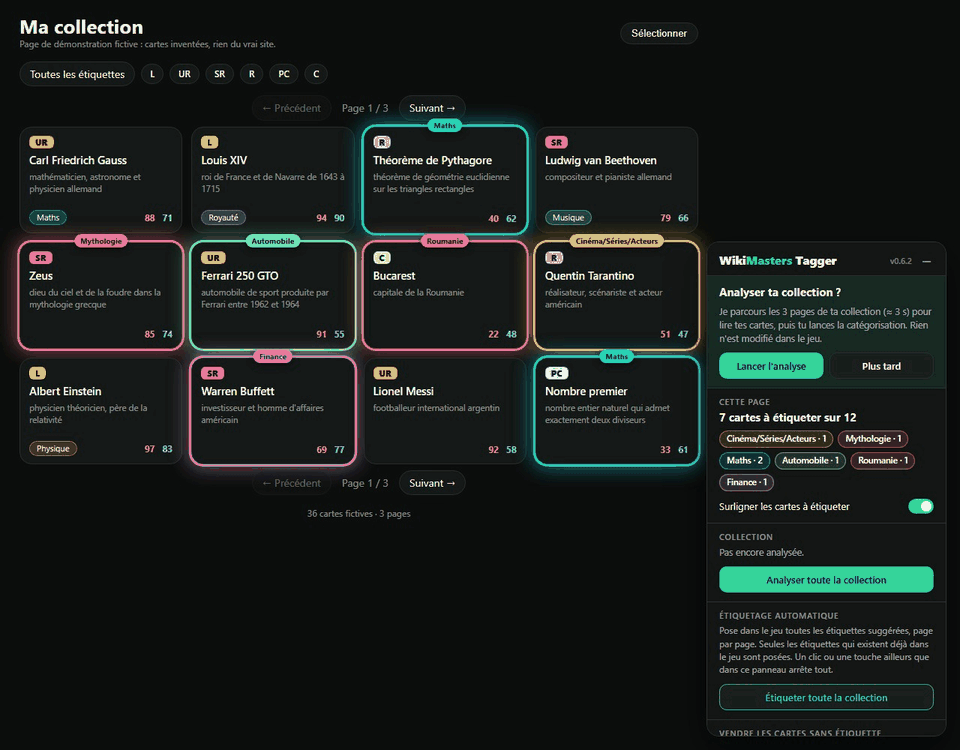

# WikiMasters Tagger

> Projet personnel, non affilié à WikiMasters.

Extension Chrome qui range ta collection [WikiMasters](https://www.wiki-masters.com) : elle
propose une étiquette pour chaque carte, les pose dans le jeu, vend les cartes sans étiquette
et ouvre tes paquets. Un script Python fait la même catégorisation hors ligne.



## Installation

1. Ouvre `chrome://extensions` et active le **mode développeur**.
2. **Charger l'extension non empaquetée** → choisis le dossier `extension/`.
3. Épingle l'icône dans la barre d'outils.

Après une mise à jour du code : ↻ dans `chrome://extensions`, puis recharge l'onglet WikiMasters.

## Utilisation

Le panneau **Tagger** apparaît en bas à droite sur les pages Collection et Paquets.

### Collection

- **Analyser toute la collection** : lit toutes les pages (sans filtre actif).
- **Catégoriser et ouvrir le rapport** : cartes à étiqueter, fiabilité des règles, thèmes
  récurrents. Les cartes à étiqueter sont aussi surlignées sur la page.
- **Étiqueter toute la collection** : pose les étiquettes suggérées, page par page. Seules les
  étiquettes qui existent déjà dans le jeu sont posées. Reprend là où il s'était arrêté.
- **Vendre les cartes sans étiquette** : choisis les raretés, confirme. Irréversible
  (1 wikibidou par carte). Les favoris sont toujours gardés, les shiny aussi (réglable).

### Paquets

- **Rappels** : nombre de paquets estimé sur l'icône, notification quand le stock est plein.
- **Défilement et enchaînement** : après ton clic sur « Ouvrir », fait défiler les cartes,
  clique sur « Continuer » et rouvre les paquets disponibles.
- **Pilote** (désactivé par défaut) : ouvre les paquets dès qu'ils arrivent, puis étiquette
  les cartes tirées dans ta Collection et revient attendre le suivant. Option « Puis vendre les
  cartes sans étiquette » (raretés choisies dans le panneau de la Collection) : le pilote ne
  vend jamais une carte qui a une étiquette suggérée, et s'arrête si une carte qu'il vient
  d'étiqueter apparaît sans étiquette.
- **Surenchère** (option du pilote, désactivée par défaut) : sur Marché > Mes enchères, le
  pilote resurenchérit de la mise minimum sur tes enchères « Surenchéri » si elle reste sous
  un facteur × la moyenne des ventes (réglable par carte sur la page de l'enchère) et que ton
  solde suffit ; s'il reste moins de 5 min, il attend les 12 dernières secondes.

### Bon à savoir

- L'extension clique comme une vraie souris via le mode débogage de Chrome : pendant qu'elle
  travaille, le bandeau « … a commencé à déboguer ce navigateur » s'affiche. Laisse-le ouvert.
  L'onglet du jeu peut rester en arrière-plan, et n'importe quel format de fenêtre convient.
- Seuls les boutons **Arrêter** du panneau arrêtent un automatisme.
- La vérification « je ne suis pas un robot » met tout en pause, sans jamais y toucher. Une
  sanction affichée par le site arrête tout.
- Les noms d'étiquettes doivent être exactement ceux du jeu. La page **Config** (lien du
  panneau) permet de modifier étiquettes, mots-clés et réglages.
- Option Wikidata (dans la Config) : affine la catégorisation. Renseigne ton e-mail avant,
  Wikimedia le demande.
- Collecte du marché (Config, désactivée par défaut) : relevé des enchères en lecture seule,
  pour estimer les prix. Elle ne mise jamais (seule la surenchère du pilote mise).
- Si le site change, **Exporter la page** (lien du panneau) enregistre la page à fournir pour
  adapter l'extension.

## Script Python

Python 3.11+, sans dépendance. Copie le texte de tes pages Collection (Ctrl+A, Ctrl+C) dans
`input/page01.txt`, puis :

```
python -m wmtag              # résultats dans output/ (rapport.html, a_etiqueter.md, classement.csv)
python -m wmtag --wikidata   # avec Wikidata (e-mail dans config.toml)
```

Les règles sont dans `rules.toml` (étiquettes et mots-clés) et `themes.toml` (thèmes
candidats). Après modification : `python extension/build_defaults.py` pour les reprendre dans
l'extension.

## Tests

```
python -m unittest -v                       # Python, et parité avec l'extension (Node.js)
python extension/tests/harness/run.py       # extension dans un vrai navigateur (Edge ou Chrome)
```
